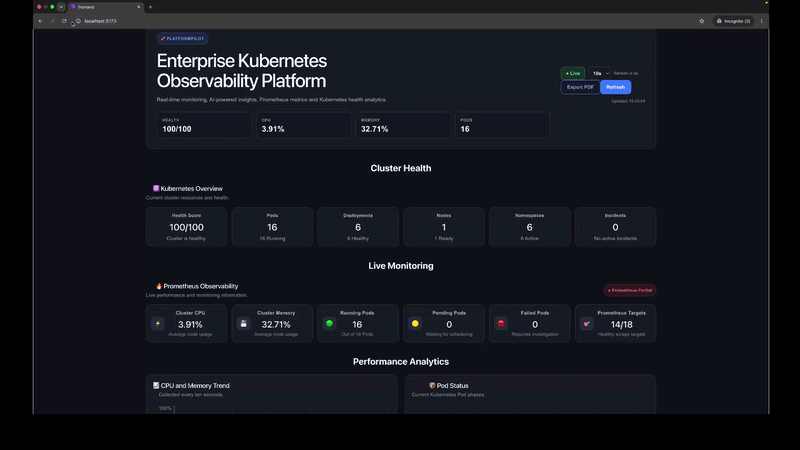
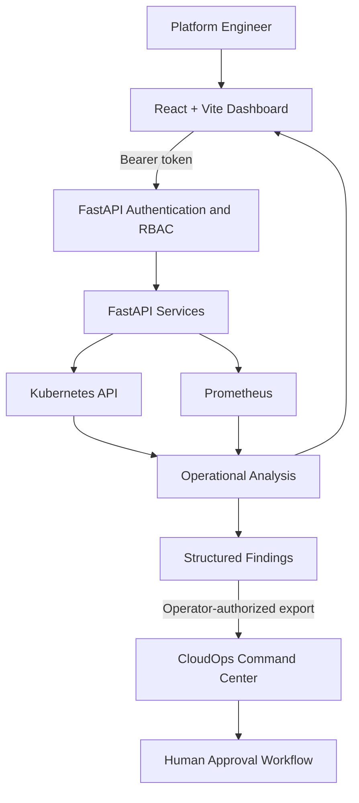
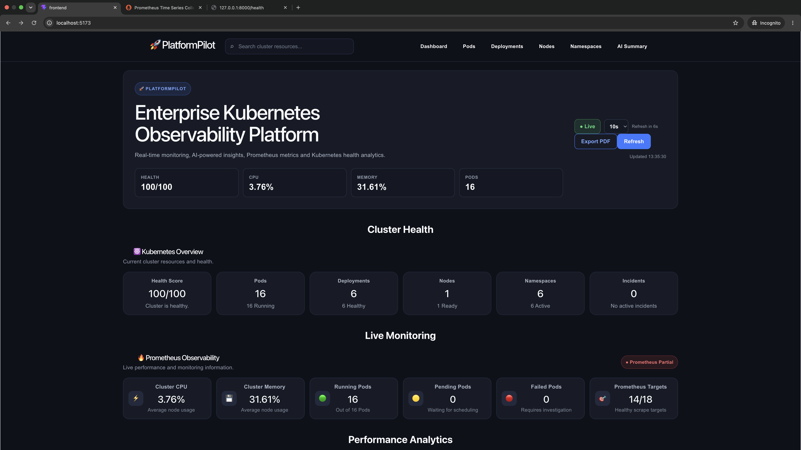
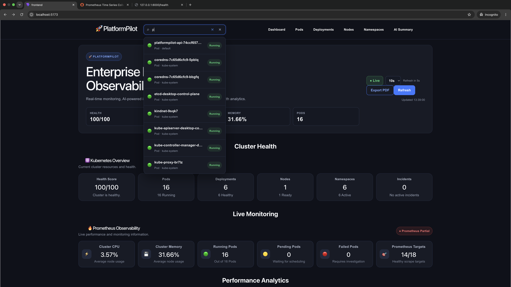
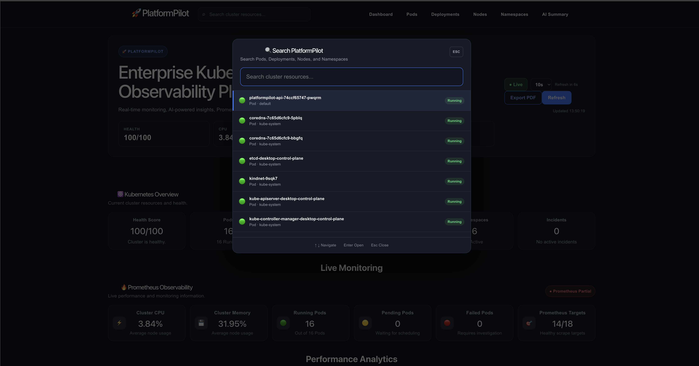
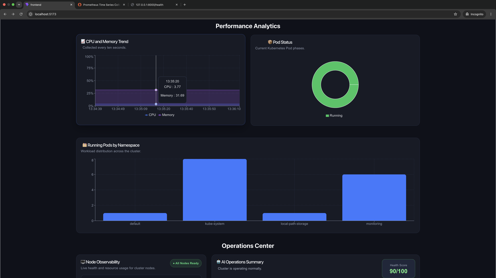
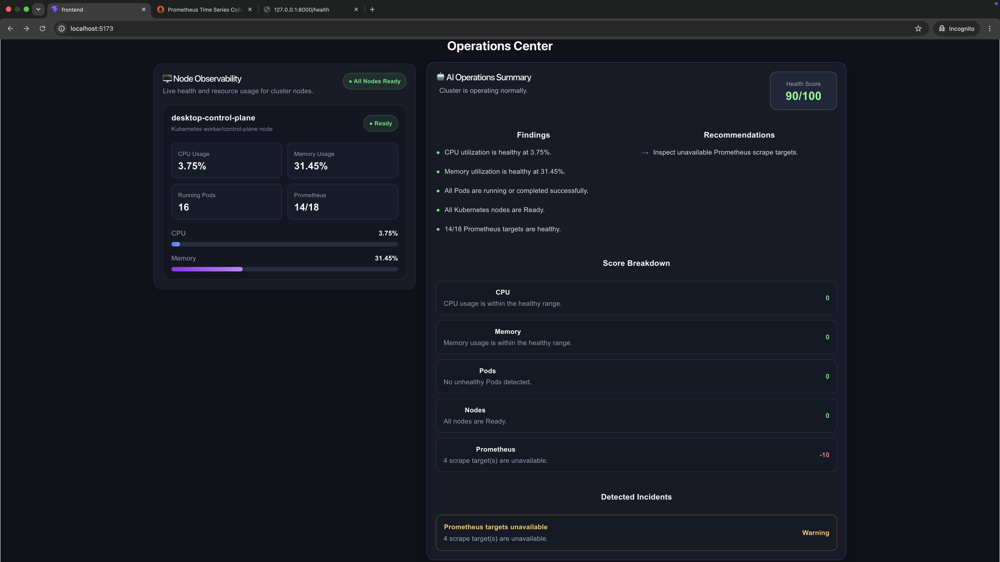
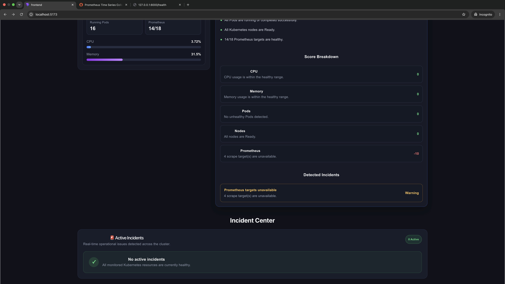
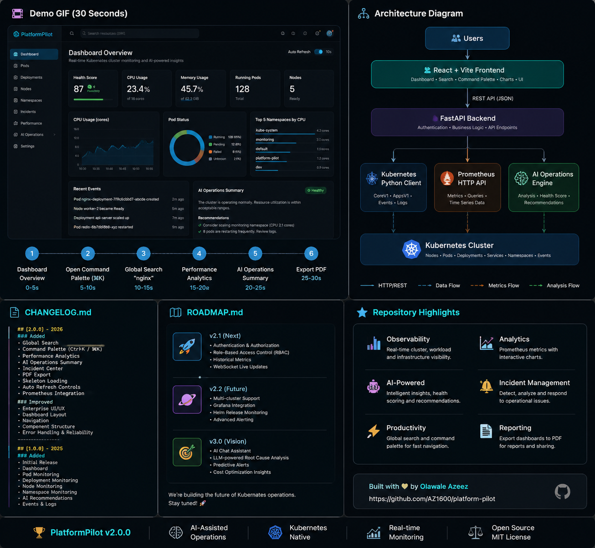

# PlatformPilot

[](https://github.com/AZ1600/platform-pilot/actions/workflows/ci.yml)


**An AI-assisted Kubernetes observability and operations platform with role-based API access, infrastructure monitoring, incident investigation and controlled CloudOps integration.**

PlatformPilot combines **React, FastAPI, Kubernetes APIs and Prometheus** to help platform engineers investigate infrastructure health, monitor workloads, examine operational findings and export incidents into approval-gated workflows.

The project demonstrates full-stack platform engineering, backend authorization, service integration, automated testing and container-oriented development.

**Explore:** [Technical Review](#technical-review--start-here) · [Architecture](#system-architecture) · [Security](#authentication-and-rbac) · [Validation](#testing-and-validation) · [Getting Started](#getting-started) · [Limitations](#scope-and-limitations)

---

## Demo



The recorded demonstration showcases the dashboard and operational investigation interface.

> [!IMPORTANT]
> PlatformPilot is a Kubernetes operations portfolio project. Live cluster and Prometheus capabilities require configured infrastructure. Its role-scoped bearer tokens are a lightweight application authentication mechanism, not an enterprise identity provider. CloudOps export records operational findings for review; it does not authorize or execute infrastructure remediation.

---

## Technical Review — Start Here

For recruiters and engineers reviewing the implementation, the following links provide a direct path to the most important code and evidence.

| Engineering Area | What to Review | Evidence |
| --- | --- | --- |
| Architecture | React, FastAPI, Kubernetes, Prometheus and integration boundaries | [Architecture guide](docs/ARCHITECTURE.md) |
| API authentication | Bearer-token validation, role hierarchy and fail-closed responses | [Security implementation](backend/core/security.py) |
| API authorization | Protected read and operational endpoints | [RBAC regression tests](backend/tests/test_rbac_routes.py) |
| Authentication edge cases | Invalid credentials, role handling and authorization failures | [Security tests](backend/tests/test_security.py) |
| CloudOps integration | Protected incident export and service-level failure handling | [Export service](backend/services/cloudops_export_service.py) |
| Operational findings | Incident-to-finding transformation | [Finding service](backend/services/operational_finding_service.py) |
| Frontend authentication | Runtime validation and browser session token handling | [API access component](frontend/src/components/ApiAccess.jsx) |
| CI/CD | Backend regression tests, frontend lint and production build | [GitHub Actions workflow](.github/workflows/ci.yml) |

### Validation at a Glance

| Check | Verified result |
| --- | --- |
| Backend regression tests | **44 passed** locally on 30 October 2026 |
| Backend test warnings | 1 third-party Starlette TestClient deprecation warning |
| Frontend ESLint | Passed |
| Frontend production build | Passed |
| Dependency security audit | **0 reported vulnerabilities** after lockfile updates |
| Clean dependency installation | `npm ci` passed with the updated lockfile |
| Frontend dependency changes | 13 packages updated during audit remediation |

The vulnerability count is an npm audit snapshot, not a guarantee that the application is free of security defects. CI verifies automated checks; it does not validate a live Kubernetes deployment or enterprise production readiness.

---

## The Engineering Problem

Kubernetes environments expose operational information through multiple systems.

Engineers often need to examine:

- Pod health and container failures
- Deployment readiness and availability
- Node health and capacity
- Namespace state
- Kubernetes events and container logs
- Prometheus metrics
- Infrastructure incidents and operational recommendations

This information can be distributed across dashboards, command-line tools, API responses and monitoring systems.

PlatformPilot consolidates supported operational views into a single interface while separating **read-only investigation from privileged operational actions**.

The CloudOps integration extends the workflow by exporting structured findings to a separate approval-controlled platform.

---

## Key Capabilities

### Kubernetes Observability

- Cluster health overview
- Pod, Deployment, Node and Namespace inspection
- Kubernetes resource discovery
- Container log inspection
- Kubernetes event investigation
- Cluster health scoring
- Manual and automatic data refresh

### Monitoring and Analysis

- Prometheus-backed metrics when a monitoring endpoint is available
- CPU and memory visualizations
- Performance analytics
- Infrastructure health summaries
- Operational findings and incident analysis
- AI-assisted operational recommendations

### Engineering Productivity

- Global Kubernetes resource search
- Command Palette using `Ctrl + K` or `Cmd + K`
- Keyboard navigation
- Resource-specific detail pages
- PDF report export
- Responsive dashboard interface

### Security and Operational Control

- Backend bearer-token authentication
- `viewer`, `operator` and `admin` roles
- Protected Kubernetes and monitoring endpoints
- Operator-only CloudOps export
- Server-side authorization
- Runtime token validation
- Session-scoped frontend token storage
- Separate PlatformPilot and CloudOps credentials

---

## System Architecture

PlatformPilot uses a React frontend and a FastAPI backend to connect Kubernetes data, Prometheus metrics and operational analysis.



### Architectural Responsibilities

| Component | Responsibility |
| --- | --- |
| React frontend | Dashboard, navigation, resource views and user interaction |
| FastAPI backend | Authentication, API endpoints and operational service orchestration |
| Kubernetes client | Retrieve workload, cluster and resource information |
| Prometheus integration | Query supported operational metrics |
| Analysis services | Produce health summaries and operational recommendations |
| Security layer | Authenticate requests and enforce minimum roles |
| CloudOps export service | Transform and deliver structured operational findings |
| GitHub Actions | Validate backend tests, frontend lint and build |

The backend must have suitable Kubernetes and Prometheus connectivity for the corresponding live features to work.

For more details, see [architecture documentation](docs/ARCHITECTURE.md).

---

## Authentication and RBAC

PlatformPilot implements server-side, role-scoped bearer-token authentication.

The current role hierarchy is:

```text
viewer
   |
   v
operator
   |
   v
admin
```

Higher roles inherit the permissions of lower roles.

### Role Permissions

| Role | Capabilities |
| --- | --- |
| Viewer | Read supported operational resources, monitoring data and analysis |
| Operator | Viewer access plus protected operational actions such as CloudOps export |
| Admin | Operator and viewer permissions, with the highest current application role |

### Authentication Behaviour

| Condition | HTTP response |
| --- | --- |
| No PlatformPilot authentication tokens configured | 503 Service Unavailable |
| Missing or invalid bearer token | 401 Unauthorized |
| Valid token with insufficient role | 403 Forbidden |
| Valid token with sufficient role | Request proceeds |

Bearer-token comparison uses `secrets.compare_digest` in the backend.

Authentication is enforced through FastAPI dependencies rather than relying on hidden frontend controls.

[Security implementation](backend/core/security.py) · [Security tests](backend/tests/test_security.py)

### Authenticated Principal Endpoint

The backend provides:

```text
GET /auth/me
```

This endpoint validates the caller's bearer token independently of Kubernetes and Prometheus availability.

Example response:

```json
{
  "authenticated": true,
  "role": "viewer"
}
```

### Frontend Authentication Flow

```text
User enters API token
        |
        v
Frontend calls /auth/me
        |
        v
FastAPI validates bearer token
        |
        v
Backend returns assigned role
        |
        v
Frontend stores validated token
in browser sessionStorage
        |
        v
Protected API requests use token
```

The browser does not receive a hardcoded PlatformPilot token through the Vite production bundle.

The implementation uses `sessionStorage` for token persistence within the browser session. This is not equivalent to a hardened identity session with short-lived, server-managed credentials.


---

## CloudOps Integration

PlatformPilot can generate structured findings from operational incidents and send them to CloudOps Command Center.

This integration preserves two independent security boundaries.

### Boundary 1 — Calling PlatformPilot

A caller must authenticate with a PlatformPilot bearer token and have at least the `operator` role to invoke:

```text
POST /cloudops/findings
```

A `viewer` receives HTTP 403 before the export operation is performed.

### Boundary 2 — PlatformPilot Calling CloudOps

Once the request passes PlatformPilot authorization, the backend uses its separately configured CloudOps ingestion credential for outbound delivery.

```text
PlatformPilot caller
        |
        | Operator or Admin token
        v
PlatformPilot API
        |
        | CLOUDOPS_INGEST_TOKEN
        v
CloudOps ingestion endpoint
        |
        v
Finding validation and storage
        |
        v
Human-controlled review
```

The integration supports:

- Structured operational finding generation
- Unique finding identifiers
- UTC observation timestamps
- Environment and cluster metadata
- Authenticated outbound delivery
- Error handling for external-service failures
- Contract-oriented finding representation

A successful export does not mean remediation was performed.

[CloudOps router](backend/routers/cloudops.py) · [Export service](backend/services/cloudops_export_service.py) · [Export tests](backend/tests/test_cloudops_export_service.py)

---

## Operational Investigation

### Dashboard

Displays cluster health, workload summaries, resource statistics and operational information.



### Global Search

Allows engineers to discover Kubernetes Pods, Deployments, Nodes and Namespaces.



### Command Palette

Provides keyboard-driven navigation and resource discovery.



### Performance Analytics

Displays operational metrics and resource analysis when monitoring data is available.



### AI Operations Summary

Presents health analysis, operational findings and recommendations.



### Incident Center

Provides a centralized view for investigating operational incidents.



### Project Overview



---

## Technology Stack

| Layer | Technologies |
| --- | --- |
| Frontend | React 19, React Router, Vite, JavaScript and CSS |
| Backend | FastAPI, Python 3.11 and Uvicorn |
| Kubernetes integration | Kubernetes Python Client |
| Monitoring | Prometheus HTTP API |
| Data visualization | Recharts |
| Authentication | Bearer tokens and role-based FastAPI dependencies |
| Testing | Pytest, FastAPI TestClient, HTTPX |
| Frontend validation | ESLint and Vite build |
| CI/CD | GitHub Actions |
| Infrastructure | Docker and Kubernetes manifests |
| External integration | CloudOps Command Center ingestion API |

---

## Testing and Validation

### Backend Tests

From the repository root, with the Python 3.11 virtual environment active:

```bash
python -m pytest -q
```

Verified locally on 30 October 2026:

```text
44 passed, 1 warning
```

The single recorded warning originates from a deprecated Starlette/FastAPI test-client import path. It did not cause a test failure.

The suite includes tests for:

- Authentication configuration
- Invalid and missing bearer tokens
- Viewer, operator and admin permissions
- Protected resource endpoints
- Public health access
- `/auth/me`
- CloudOps routing and export
- Operational finding generation
- Kubernetes pod route behaviour
- Downstream service failures

[Backend tests](backend/tests/)

### Frontend Validation

```bash
cd frontend
npm ci
npm run lint
npm run build
```

These commands validate dependency installation, ESLint configuration and production asset generation.

### Dependency Security

The frontend dependency lockfile was refreshed on 30 October 2026 after npm reported one critical and four high-severity advisories.

The changes were limited to the dependency lockfile. The subsequent clean installation, audit, lint and production build passed.

To reproduce the audit using the current lockfile:

```bash
cd frontend
npm ci
npm audit --omit=dev
npm audit
```

The recorded results reported zero known vulnerabilities at the time of testing. New advisories may appear as dependencies and security databases evolve.

### Continuous Integration

[GitHub Actions CI](.github/workflows/ci.yml) runs on pull requests and pushes to `main`.

The workflow includes:

**Backend**
- Python 3.11 setup
- Development dependency installation
- Pytest regression tests

**Frontend**
- Node.js 22 setup
- Locked dependency installation
- ESLint validation
- Vite production build

The workflow uses read-only repository permissions. Passing CI verifies these checks; it does not establish live Kubernetes functionality or deployment readiness.

---

## Getting Started

### Requirements

- Python 3.11
- Node.js 22-compatible environment
- npm
- Kubernetes environment for live cluster functionality
- Prometheus for supported monitoring features
- Optional CloudOps Command Center instance for finding export

### Clone the Repository

```bash
git clone https://github.com/AZ1600/platform-pilot.git
cd platform-pilot
```

### Backend Setup

Create a virtual environment:

```bash
python3.11 -m venv .venv
source .venv/bin/activate
```

Install dependencies:

```bash
python -m pip install -r backend/requirements-dev.txt
```

Configure development tokens in the environment:

```bash
export PLATFORM_VIEWER_TOKEN="replace-with-long-random-token"
export PLATFORM_OPERATOR_TOKEN="replace-with-long-random-token"
export PLATFORM_ADMIN_TOKEN="replace-with-long-random-token"
```

For optional CloudOps integration:

```bash
export CLOUDOPS_INGEST_TOKEN="replace-with-cloudops-ingest-token"
export CLOUDOPS_FINDINGS_URL="http://127.0.0.1:3000/api/platform-pilot/findings"
export PLATFORM_ENVIRONMENT="local"
export KUBERNETES_CLUSTER_NAME="docker-desktop"
```

These are placeholder examples. Use unique randomly generated secrets for real use.

The backend configuration template is available at [backend/.env.example](backend/.env.example). Setting values in a file alone does not automatically export them into the shell.

Start the API:

```bash
cd backend
uvicorn app:app --reload
```

Default backend address:

```text
http://127.0.0.1:8000
```

Interactive API documentation:

```text
http://127.0.0.1:8000/docs
```

Public application health check:

```bash
curl http://127.0.0.1:8000/health
```

The health check verifies application responsiveness, not Kubernetes or Prometheus availability.

### Frontend Setup

Open a second terminal at the repository root:

```bash
cd frontend
cp .env.example .env
npm ci
npm run dev
```

Frontend URL:

```text
http://localhost:5173
```

The default frontend API configuration points to:

```text
http://127.0.0.1:8000
```

Set `VITE_API_URL` in `frontend/.env` if the backend is hosted elsewhere.

### Connecting the Frontend

After both services are running:

1. Open the frontend in your browser.
2. Select **API Access**.
3. Enter a configured PlatformPilot bearer token.
4. Select **Validate & Save**.
5. Confirm that the backend validates the token through `/auth/me`.
6. Use the available dashboards according to the authorized role.

Kubernetes and Prometheus functionality depends on the backend's access to those services.

---

## API Authentication Examples

### Public Health Check

```bash
curl -i http://127.0.0.1:8000/health
```

Expected HTTP status:

```text
200 OK
```

### Authenticated Viewer

```bash
curl -i \
  -H "Authorization: Bearer $PLATFORM_VIEWER_TOKEN" \
  http://127.0.0.1:8000/auth/me
```

Expected response:

```json
{
  "authenticated": true,
  "role": "viewer"
}
```

### Viewer Authorization Boundary

```bash
curl -i \
  -X POST \
  -H "Authorization: Bearer $PLATFORM_VIEWER_TOKEN" \
  http://127.0.0.1:8000/cloudops/findings
```

Expected:

```text
403 Forbidden
```

### Operator Identity

```bash
curl -i \
  -H "Authorization: Bearer $PLATFORM_OPERATOR_TOKEN" \
  http://127.0.0.1:8000/auth/me
```

Expected response:

```json
{
  "authenticated": true,
  "role": "operator"
}
```

The operator role permits the CloudOps export route, but successful export still depends on the availability and configuration of downstream services.

---

## Repository Structure

```text
platform-pilot/
├── backend/
│   ├── app.py
│   ├── core/
│   │   ├── config.py
│   │   └── security.py
│   ├── routers/
│   │   ├── ai.py
│   │   ├── cloudops.py
│   │   ├── metrics.py
│   │   └── ...
│   ├── services/
│   ├── tests/
│   ├── Dockerfile
│   ├── requirements.txt
│   └── requirements-dev.txt
├── frontend/
│   ├── src/
│   │   ├── components/
│   │   ├── pages/
│   │   └── services/
│   ├── package.json
│   ├── package-lock.json
│   └── vite.config.js
├── infrastructure/
│   ├── backend-deployment.yaml
│   ├── backend-service.yaml
│   └── monitoring-values-docker-desktop.yaml
├── docs/
│   ├── ARCHITECTURE.md
│   ├── ROADMAP.md
│   └── LEARNING-JOURNAL.md
├── screenshots/
├── .github/workflows/ci.yml
├── CONTRIBUTING.md
├── CHANGELOG.md
├── LICENSE
└── README.md
```

---

## Scope and Limitations

PlatformPilot demonstrates practical Kubernetes and platform engineering workflows, but its current implementation has defined limitations.

- **Infrastructure:** Live functionality depends on a configured Kubernetes environment and supported monitoring services. Local tests use controlled dependencies and do not prove a live cluster is healthy.
- **Identity:** Application authentication relies on configured bearer tokens rather than OIDC, SSO or centralized user identities.
- **Browser security:** The frontend stores the validated API token in `sessionStorage`. This does not eliminate risks from malicious scripts or compromised browser sessions.
- **Authorization:** Server-side role checks govern protected endpoints. Separate Kubernetes RBAC and cloud IAM permissions must also be configured appropriately.
- **Observability:** The current platform does not claim multi-cluster inventory, long-term historical metrics storage or complete production monitoring coverage.
- **AI assistance:** Operational summaries and recommendations are assistance for engineers, not a substitute for independent diagnosis or verification.
- **CloudOps:** Findings can be exported, but remediation authorization and execution are separate concerns. Export does not change infrastructure.
- **Security audit:** A clean npm audit is a useful dependency check, not a comprehensive vulnerability assessment.
- **Production readiness:** Enterprise identity integration, stronger session controls, operational hardening and additional end-to-end tests remain future work.

---

## Roadmap

### Implemented Capabilities

- Kubernetes resource monitoring
- Cluster health dashboard and scoring
- Prometheus integration
- Performance analytics
- Operational health summaries
- Global resource search
- Command Palette
- Incident investigation
- Container log inspection
- PDF export
- Responsive React interface
- CloudOps operational finding export
- Authenticated outbound CloudOps delivery
- Role-scoped FastAPI authentication
- Protected read and operational endpoints
- Authenticated `/auth/me` endpoint
- Frontend token validation and session handling
- Security and integration regression tests
- GitHub Actions backend/frontend validation
- Frontend code splitting
- Frontend dependency security remediation

### Future Improvements

- OIDC and external identity-provider integration
- Short-lived access tokens and managed sessions
- Multi-cluster operations
- Historical metrics persistence
- Expanded monitoring integrations
- Additional automated frontend tests
- End-to-end Kubernetes integration tests
- Improved application and deployment observability
- Expanded AI-assisted analysis with independent evaluation
- Production-oriented deployment and security hardening

Future enhancements are not presented as already implemented.

---

## Engineering Skills Demonstrated

**Platform Engineering**
- Kubernetes operational visibility
- Resource and workload investigation
- Incident handling and analysis
- Service-to-service integration
- Operational security boundaries

**Backend Development**
- FastAPI application design
- Python service integration
- API authentication and authorization
- Error handling and regression testing

**Frontend Engineering**
- React and Vite
- Responsive operational dashboards
- Resource search and navigation
- Browser-session authentication
- Data visualization and performance-oriented code splitting

**DevOps and Security**
- GitHub Actions CI
- Pytest and ESLint
- Production asset builds
- Dependency vulnerability remediation
- Authentication and role-based access controls

---

## Contributing

Contributions and suggestions are welcome.

Please read [CONTRIBUTING.md](CONTRIBUTING.md) before submitting a pull request.

## License

Licensed under the [MIT License](LICENSE).

## Author

**Olawale Azeez**

Cloud Engineer | Platform Engineer | DevOps Engineer

[GitHub](https://github.com/AZ1600) · [Portfolio](https://az1600.github.io/)
