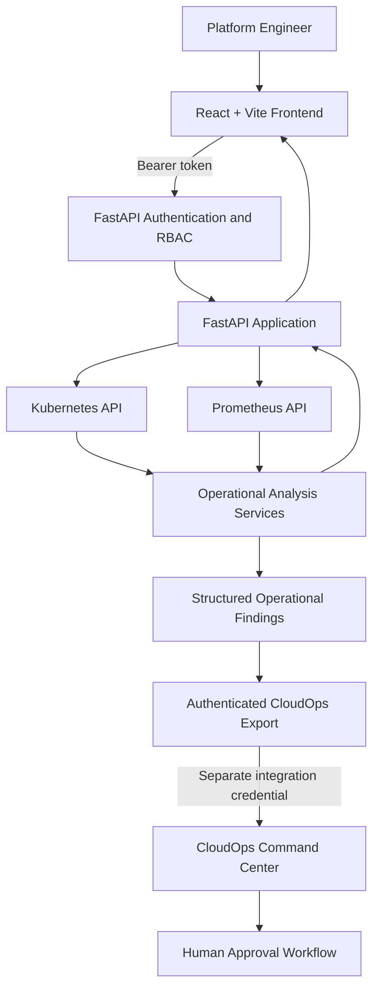

# PlatformPilot — System Architecture

## Overview

PlatformPilot is a full-stack Kubernetes observability and operational-assistance platform built with React, FastAPI, the Kubernetes Python Client and Prometheus.

The system combines infrastructure visibility, operational analysis, role-based API authorization and controlled integration with CloudOps Command Center.

The architecture separates three responsibilities:

1. **Presentation:** Visualizing cluster state and helping engineers investigate resources.
2. **Analysis:** Retrieving infrastructure information and producing operational findings.
3. **Authorization:** Enforcing access controls before protected reads or operational exports.

The current implementation is designed primarily for development and lab environments. Live monitoring requires configured Kubernetes and Prometheus access.

---

## High-Level Architecture



The frontend cannot grant itself authorization. Protected API operations are checked by FastAPI dependencies.

CloudOps integration uses a separate credential and does not execute infrastructure remediation.

---

## Frontend Architecture

**Technology:** React 19, Vite, React Router, JavaScript, CSS and Recharts.

The frontend provides:

- Kubernetes health dashboard
- Pod, Deployment, Node and Namespace views
- Global resource search
- Keyboard-driven Command Palette
- Performance analytics
- Operational health summaries
- Incident investigation
- PDF report export
- Runtime API authentication

### Authentication Flow

```text
User enters PlatformPilot API token
             |
             v
Frontend sends GET /auth/me
             |
             v
FastAPI validates bearer token
             |
             v
Backend returns authenticated role
             |
             v
Frontend stores validated token
in browser sessionStorage
             |
             v
Protected requests include bearer token
```

The frontend does not embed real PlatformPilot tokens into its production bundle.

Browser session storage is a development-oriented mechanism, not a replacement for hardened enterprise identity management.

Relevant implementation:

- `frontend/src/components/ApiAccess.jsx`
- `frontend/src/services/auth.js`
- `frontend/src/services/api.js`
- `frontend/src/pages/Dashboard.jsx`

---

## Backend Architecture

**Technology:** Python 3.11, FastAPI, Uvicorn, Kubernetes Python Client and Requests.

The backend is responsible for:

- Authenticating API requests
- Enforcing minimum authorization roles
- Retrieving Kubernetes resources
- Querying Prometheus
- Collecting events and logs
- Calculating health summaries
- Generating operational findings
- Exporting incidents to CloudOps

### Key Components

| Component | Responsibility |
| --- | --- |
| `backend/app.py` | FastAPI application and resource endpoints |
| `backend/core/security.py` | Bearer-token validation and role enforcement |
| `backend/core/config.py` | Environment-based service configuration |
| `backend/kubernetes_client.py` | Kubernetes resource access |
| `backend/services/prometheus_service.py` | Prometheus metric queries |
| `backend/services/ai_service.py` | Rule-based health scoring and recommendations |
| `backend/services/operational_finding_service.py` | Incident-to-finding transformation |
| `backend/services/cloudops_export_service.py` | Authenticated finding delivery |
| `backend/routers/cloudops.py` | Operator-protected export endpoint |

---

## Authentication and Authorization

PlatformPilot implements role-scoped bearer-token authentication.

### Role Hierarchy

```text
viewer
   |
   v
operator
   |
   v
admin
```

Higher roles inherit the permissions of lower roles.

| Role | Access |
| --- | --- |
| Viewer | Read protected Kubernetes, monitoring and analysis information |
| Operator | Viewer access plus operational finding export |
| Admin | Operator and viewer permissions, with the highest current application role |

### Fail-Closed Behaviour

| Condition | Response |
| --- | --- |
| Authentication not configured | HTTP 503 |
| Missing or invalid bearer token | HTTP 401 |
| Valid token with insufficient privileges | HTTP 403 |
| Valid token with sufficient privileges | Request proceeds |

Token comparison uses Python's `secrets.compare_digest`.

Authentication is enforced by the backend, not solely by frontend navigation or UI visibility.

### Security Boundaries

PlatformPilot API authorization is distinct from Kubernetes RBAC and cloud IAM.

An authenticated application user does not automatically receive unrestricted Kubernetes or cloud permissions.

The current bearer-token system does not provide centralized identity, OIDC, SSO, automatic token expiry or enterprise session management.

---

## Kubernetes Integration

The backend uses the Kubernetes Python Client to retrieve operational resources.

Supported information includes:

- Pods
- Deployments
- Nodes
- Namespaces
- Kubernetes events
- Container logs
- Resource status

Actual API capabilities depend on the configured Kubernetes context, cluster availability and the permissions of the backend's Kubernetes identity.

The application does not automatically provision a Kubernetes cluster.

---

## Prometheus Integration

The backend queries the Prometheus HTTP API for supported operational metrics.

Prometheus data is used in:

- CPU and memory analysis
- Cluster health assessment
- Pod and Node monitoring
- Resource utilization views
- Operational recommendations

The integration uses configured request timeouts and raises specific errors for connectivity and query failures.

Missing or unavailable Prometheus data should not be interpreted as proof that infrastructure is healthy.

Relevant implementation:

`backend/services/prometheus_service.py`

---

## Operational Analysis

PlatformPilot provides deterministic, rule-based operational analysis.

Current logic evaluates Kubernetes and Prometheus data to produce:

- Health scores
- Findings
- Severity classifications
- Incident records
- Recommended investigation steps

For example, elevated CPU or memory usage can produce findings and recommendations. Unhealthy Pods and Nodes can affect the health score.

These capabilities do not currently establish independent LLM reasoning or automated root-cause verification.

The results should support engineering investigation rather than replace human judgment.

---

## CloudOps Integration Architecture

PlatformPilot exports structured operational findings to CloudOps Command Center.

This integration intentionally maintains two separate authentication boundaries.

### Boundary 1 — PlatformPilot API

The caller must be authenticated with a PlatformPilot token.

The endpoint:

`POST /cloudops/findings`

requires an `operator` or `admin` role.

A `viewer` receives HTTP 403.

### Boundary 2 — CloudOps Delivery

After authorization succeeds, PlatformPilot uses its configured `CLOUDOPS_INGEST_TOKEN` for outbound delivery.

```text
Authenticated Operator
         |
         v
PlatformPilot Authorization
         |
         v
Operational Incident Analysis
         |
         v
Structured Finding Generation
         |
         v
CloudOps Export Service
         |
         | Independent integration token
         v
CloudOps Command Center
         |
         v
Human Approval Boundary
```

Findings include relevant metadata such as identifiers, observation timestamps, cluster and environment context.

**Exporting a finding does not approve remediation or modify infrastructure.**

---

## Testing and Continuous Integration

PlatformPilot uses automated backend tests and frontend validation.

### Backend

The regression tests cover:

- Authentication and authorization
- Role-protected API routes
- Kubernetes pod routes
- Configuration validation
- Operational finding generation
- CloudOps export behaviour
- Downstream integration errors

Recorded baseline on 30 October 2026:

**44 passing backend tests.**

### Frontend

The frontend is validated using ESLint and a Vite production build.

The frontend dependency lockfile was also refreshed after a security audit. A fresh installation and subsequent audit reported zero known vulnerabilities on 30 October 2026.

### GitHub Actions

The CI pipeline runs on pull requests and pushes to `main`.

It includes:

- Python 3.11 backend tests
- Node.js 22 dependency installation
- Frontend linting
- Frontend production build

Passing CI does not substitute for live Kubernetes integration tests, penetration testing or production operational validation.

---

## Current Limitations

- Kubernetes and Prometheus must be configured and reachable for live functionality.
- Application identity relies on configured bearer tokens.
- Browser tokens are stored in `sessionStorage`.
- Long-term metrics persistence is not implemented as a dedicated historical monitoring system.
- The current implementation is not a multi-cluster management platform.
- Operational analysis is primarily rule-based.
- CloudOps export does not execute remediation.
- Automated tests do not verify every possible production infrastructure failure.
- A clean dependency audit does not guarantee complete security.

---

## Future Architecture Improvements

Potential enhancements include:

- OIDC, SSO and Microsoft Entra ID integration
- Short-lived managed authentication sessions
- Multi-cluster Kubernetes monitoring
- Historical metrics storage
- Grafana integration
- WebSocket-based updates
- Helm release monitoring
- GitOps integration
- Additional automated frontend and end-to-end tests
- Expanded LLM-based operational analysis with independent evaluation
- Production-grade observability, security and deployment controls

These are future design directions, not already deployed capabilities.

---

## Design Principles

PlatformPilot follows these engineering principles:

1. **Server-side authorization** — protected actions require backend permission checks.
2. **Separation of concerns** — frontend presentation, backend analysis and external integrations have distinct responsibilities.
3. **Evidence-driven operations** — infrastructure data informs findings and recommendations.
4. **Controlled integration** — separate credentials protect system boundaries.
5. **Operational transparency** — documented limitations distinguish supported behaviour from future capabilities.
6. **Regression testing** — automated validation protects existing application behaviour.
7. **Extensibility** — modular services support future monitoring and identity integrations.
